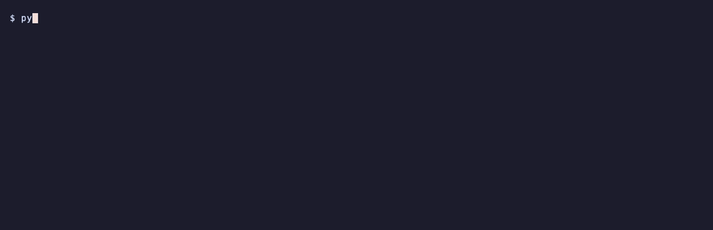
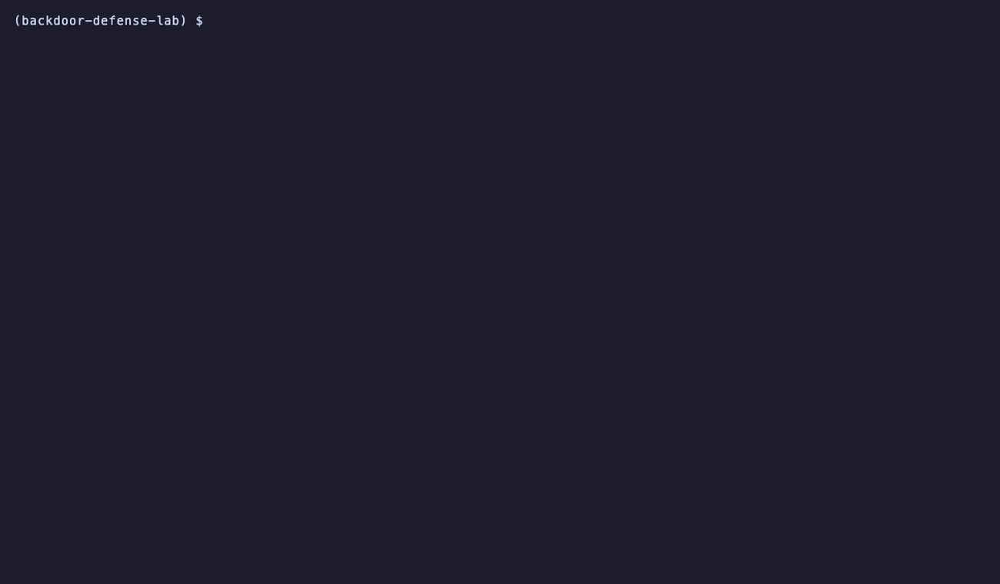

<h1 align="center">Backdoor Defense Lab</h1>

<p align="center">
  <em>Backdoor attacks and defenses for image and text classifiers, measured on CIFAR-10, GTSRB and SST-2.</em>
</p>

<p align="center">
  <a href="https://github.com/adeoluo/backdoor-defense-lab/actions/workflows/ci.yml"></a>
  <a href="https://github.com/adeoluo/backdoor-defense-lab/releases"></a>
  
  <a href="LICENSE"></a>
</p>

---

## Motivation

A backdoor (trojan) is planted by poisoning a small share of a model's training data: the model
behaves normally on clean inputs but predicts the attacker's class whenever a trigger is
present. Because clean accuracy hardly moves, ordinary evaluation does not reveal it. Defenses
attack the problem at three points: inspect the training data, filter inputs at test time, or
detect and repair the model.

This repository implements four image attacks (BadNets, Blend, WaNet, clean-label), a rare-token
text backdoor, and six defenses (spectral signatures, activation clustering, STRIP, Neural
Cleanse with unlearning, fine-pruning, ONION), and measures every defense against every attack on
the full CIFAR-10, GTSRB and SST-2 datasets with several seeds. Each method has its own module
with the math in the docstring, and the shared numerical pieces (PCA, FastICA, k-means,
silhouette, AUROC) are checked against scikit-learn and IBM ART.

The point is the measurement: detection AUROC and TPR at a fixed FPR for each detector, clean
accuracy and attack success rate before and after each repair, and the cases where a defense
fails, reported with the same weight as the cases where it works.

## Architecture

<p align="center">
  
</p>

<sub>Legend: amber = entry points and external systems, indigo = core logic, green = data and state, blue = validation and control, grey = observability and outputs.</sub>

The CLI and the benchmark scripts load a dataset as uint8 arrays and poison a seeded share of
the training set with one attack, keeping the poisoning ground truth. A ResNet-9 (images) or a
small transformer encoder (text) is trained on the poisoned data and saved as weights only.
The defenses then work from the saved run: spectral signatures and activation clustering
inspect penultimate features of the training set, STRIP and ONION score test-time inputs,
Neural Cleanse reverses a trigger per class and unlearns it, and fine-pruning prunes dormant
channels and fine-tunes. Every score is compared with the ground truth into AUROC, TPR at a
fixed FPR, clean accuracy and attack success rate, one JSON file per run, and `report`
averages them over seeds. [docs/ARCHITECTURE.md](docs/ARCHITECTURE.md) follows one experiment
through the modules.

### Attacks and defenses

| Attack | Trigger | Labels | Poison budget |
|---|---|---|---|
| BadNets (Gu et al., 2017) | 3x3 checkerboard patch, bottom-right corner | flipped to target | 10% of the training set (1% ablation) |
| Blend (Chen et al., 2017) | fixed random-noise image blended at alpha 0.2 | flipped to target | 10% |
| WaNet (Nguyen and Tran, 2021) | smooth warp (k 4, strength 0.5) plus label-keeping noise warps | flipped to target | 10% (+20% noise mode) |
| Clean-label (Turner et al., 2019) | four-corner checkerboard on PGD-perturbed (eps 16/255) target images | unchanged | 50% of the target class |
| Rare token (Kurita et al., 2020) | "cf", "mn", "bb", "tq" or "mb" inserted at a random position | flipped to positive | 10% of negative texts |

| Defense | Acts on | Method |
|---|---|---|
| Spectral signatures (Tran et al., 2018) | training data | per class, score = squared projection of centered features on the top singular vector; remove the top 1.5 x the poison share |
| Activation clustering (Chen et al., 2019) | training data | per class, FastICA to 10 dimensions, then 2-means; the smaller cluster is flagged when it holds at most 35% of the class (PCA and a silhouette rule as variants) |
| STRIP (Gao et al., 2019) | test inputs | entropy of predictions over 32 superimposed clean images; triggered inputs keep low entropy |
| Neural Cleanse (Wang et al., 2019) | the model | smallest mask and pattern that flip clean images to each class; MAD anomaly index above 2 flags the class; unlearning repair |
| Fine-pruning (Liu et al., 2018) | the model | prune the last-layer channels least active on clean data until clean accuracy drops 4 points, then fine-tune |
| ONION (Qi et al., 2021) | test text | a word is suspicious when deleting it lowers GPT-2 perplexity; delete words above a threshold |

## Results

Every number below comes from a full-dataset run on one Apple M1 (8 cores, 8 GB, PyTorch MPS),
printed by `python -m backdoor_defense_lab report` from the JSON files in
[`benchmarks/results/`](benchmarks/results/). Data: CIFAR-10 (50,000 training and 10,000 test
images), GTSRB (39,209 training and 12,630 test images, 43 classes, 32x32) and SST-2 (67,349
training sentences, 872 dev sentences as the test set). Victims: a width-16 ResNet-9 (413k
parameters, 15 epochs on CIFAR-10, 10 on GTSRB) and a 2-layer transformer encoder for SST-2.
The first 5,000 test images are the defender's trusted data; accuracies and attack success
rates (ASR) use the remaining test images. Percentages; `mean ± sd` over the number of seeds in
the Seeds column, a bare number is a single seed. Detection AUROC for spectral signatures and
activation clustering is over the training images labelled with the target class (poisoned
against clean), for STRIP over 1,000 clean and 1,000 triggered held-out inputs; an AUROC below
50 means the score ranks clean examples above poisons. The
[evaluation report](docs/EVALUATION_REPORT.md) defines every column and lists the threats to
validity.

### Attacks: clean accuracy and attack success rate

| Dataset | Attack | Seeds | Poisoned | Clean acc % | ASR % | Train min |
|---|---:|---:|---:|---:|---:|---:|
| CIFAR-10 | Clean | 2 | 0 | 89.6 ± 0.4 | n/a | 14.2 ± 1.3 |
| CIFAR-10 | BadNets | 2 | 5,000 | 88.7 ± 0.1 | 100.0 ± 0.0 | 12.9 ± 1.9 |
| CIFAR-10 | Blend | 2 | 5,000 | 89.3 ± 0.2 | 100.0 ± 0.0 | 8.3 ± 1.2 |
| CIFAR-10 | WaNet | 2 | 5,000 | 86.4 ± 0.2 | 86.3 ± 3.9 | 9.2 ± 0.7 |
| CIFAR-10 | Clean-label | 2 | 2,500 | 89.1 ± 0.1 | 99.9 ± 0.0 | 8.6 ± 0.1 |
| CIFAR-10 | BadNets 1% | 2 | 500 | 89.5 ± 0.4 | 100.0 ± 0.0 | 8.5 ± 0.3 |
| GTSRB | Clean | 1 | 0 | 99.1 | n/a | 42.5 |
| GTSRB | BadNets | 1 | 3,921 | 98.9 | 100.0 | 2.5 |
| GTSRB | Blend | 1 | 3,921 | 99.5 | 100.0 | 5.3 |
| GTSRB | WaNet | 1 | 3,921 | 97.5 | 94.6 | 5.6 |
| GTSRB | Clean-label | 1 | 1,110 | 99.1 | 95.8 | 24.1 |

### Detection: training-set and input detectors

| Dataset | Attack | Seeds | Spectral AUROC | Spectral (ART variant) AUROC | AC (ICA) AUROC | AC separation | STRIP AUROC | STRIP TPR@5% | STRIP (add) AUROC |
|---|---:|---:|---:|---:|---:|---:|---:|---:|---:|
| CIFAR-10 | BadNets | 2 | 49.5 ± 0.1 | 100.0 ± 0.0 | 100.0 ± 0.0 | 100.0 ± 0.0 | 91.7 ± 5.8 | 58.6 ± 23.8 | 99.2 ± 1.0 |
| CIFAR-10 | Blend | 2 | 50.1 ± 1.4 | 0.2 ± 0.0 | 100.0 ± 0.0 | 100.0 ± 0.0 | 9.6 ± 2.6 | 0.1 ± 0.1 | 96.8 ± 0.7 |
| CIFAR-10 | WaNet | 2 | 59.9 ± 3.5 | 89.8 ± 4.9 | 98.2 ± 0.0 | 98.2 ± 0.0 | 60.3 ± 4.0 | 4.0 ± 2.3 | 47.1 ± 0.9 |
| CIFAR-10 | Clean-label | 2 | 50.0 ± 0.3 | 100.0 ± 0.0 | 50.0 ± 70.7 | 100.0 ± 0.0 | 71.4 ± 13.2 | 21.4 ± 16.9 | 97.7 ± 1.8 |
| CIFAR-10 | BadNets 1% | 2 | 100.0 ± 0.0 | 100.0 ± 0.0 | 100.0 ± 0.0 | 100.0 ± 0.0 | 98.7 ± 0.4 | 95.2 ± 1.8 | 99.9 ± 0.1 |
| GTSRB | BadNets | 1 | 16.4 | 100.0 | 0.0 | 100.0 | 52.3 | 1.4 | 95.4 |
| GTSRB | Blend | 1 | 2.0 | 0.0 | 0.0 | 100.0 | 20.8 | 0.1 | 95.1 |
| GTSRB | WaNet | 1 | 18.3 | 0.1 | 0.1 | 99.9 | 60.5 | 8.0 | 50.1 |
| GTSRB | Clean-label | 1 | 49.0 | 11.2 | 0.0 | 100.0 | 15.5 | 0.5 | 59.1 |

### Repair: Neural Cleanse unlearning and fine-pruning

| Dataset | Attack | Before CA / ASR % | NC target found | NC anomaly | NC unlearn CA / ASR % | Pruned % | Pruned CA / ASR % | Fine-pruned CA / ASR % | Fine-tune only CA / ASR % |
|---|---:|---:|---:|---:|---:|---:|---:|---:|---:|
| CIFAR-10 | BadNets | 88.8 ± 0.3 / 100.0 ± 0.0 | 2/2 | 5.2 ± 0.1 | 88.5 ± 0.4 / 1.2 ± 0.2 | 23.0 ± 3.9 | 85.9 ± 0.2 / 88.7 ± 12.1 | 88.6 ± 0.2 / 99.0 ± 0.7 | 88.6 ± 0.2 / 100.0 ± 0.0 |
| CIFAR-10 | Blend | 89.1 ± 0.3 / 100.0 ± 0.0 | 2/2 | 3.6 ± 0.5 | 88.6 ± 0.0 / 0.7 ± 0.5 | 12.1 ± 0.6 | 86.5 ± 0.1 / 99.6 ± 0.2 | 88.7 ± 0.1 / 100.0 ± 0.0 | 88.7 ± 0.2 / 99.9 ± 0.0 |
| CIFAR-10 | WaNet | 86.3 ± 0.3 / 87.2 ± 3.9 | 0/2 | 1.5 ± 0.4 | 87.3 ± 0.3 / 11.5 ± 9.8 | 31.2 ± 4.4 | 83.4 ± 0.1 / 69.0 ± 26.2 | 87.7 ± 0.6 / 15.9 ± 4.8 | 88.0 ± 0.3 / 20.7 ± 3.9 |
| CIFAR-10 | Clean-label | 89.1 ± 0.3 / 99.9 ± 0.1 | 1/2 | 2.0 ± 0.0 | 88.8 ± 0.1 / 1.1 ± 0.1 | 41.0 ± 9.4 | 86.4 ± 0.1 / 99.8 ± 0.3 | 88.8 ± 0.1 / 100.0 ± 0.0 | 89.0 ± 0.0 / 100.0 ± 0.0 |
| CIFAR-10 | BadNets 1% | 89.6 ± 0.2 / 100.0 ± 0.0 | 2/2 | 3.6 ± 1.5 | 89.1 ± 0.3 / 1.2 ± 0.1 | 27.7 ± 1.7 | 85.6 ± 0.9 / 99.9 ± 0.1 | 89.1 ± 0.4 / 99.7 ± 0.0 | 89.3 ± 0.0 / 99.9 ± 0.0 |
| GTSRB | BadNets | 98.8 / 100.0 | 1/1 | 4.2 | 99.8 / 0.0 | 18.8 | 95.2 / 3.0 | 99.9 / 26.9 | 99.9 / 100.0 |
| GTSRB | Blend | 99.4 / 100.0 | 1/1 | 3.2 | 99.9 / 3.3 | 21.9 | 96.8 / 84.6 | 99.9 / 100.0 | 99.9 / 100.0 |
| GTSRB | WaNet | 97.5 / 94.6 | 1/1 | 3.1 | 99.8 / 0.9 | 47.7 | 94.3 / 69.7 | 99.8 / 12.9 | 99.8 / 29.8 |
| GTSRB | Clean-label | 99.1 / 95.9 | 1/1 | 3.1 | 99.8 / 0.0 | 56.2 | 96.0 / 18.0 | 99.8 / 31.0 | 99.8 / 98.2 |

### Neural Cleanse as a model-level detector

| Dataset | Backdoored / clean models | Anomaly, clean | Anomaly, backdoored | Backdoored flagged | Clean flagged | Model AUROC |
|---|---:|---:|---:|---:|---:|---:|
| CIFAR-10 | 8 / 2 | 0.99 ± 0.36 | 3.08 ± 1.58 | 5/8 | 0/2 | 1.000 |
| GTSRB | 4 / 1 | 1.43 | 3.37 ± 0.52 | 4/4 | 0/1 | 1.000 |

### Text backdoor and ONION on SST-2

| Model | ONION LM | Clean acc % | ASR % | Sentence AUROC | Acc after ONION % | ASR after ONION % |
|---|---:|---:|---:|---:|---:|---:|
| Clean model | - | 75.4 ± 0.8 | 35.9 ± 6.8 | - | - | - |
| 1 trigger word | GPT-2 | 74.9 ± 1.9 | 100.0 ± 0.0 | 81.5 ± 0.3 | 73.8 ± 0.5 | 38.9 ± 1.2 |
| 1 trigger word | unigram | 74.9 ± 1.9 | 100.0 ± 0.0 | 65.8 ± 0.0 | 65.3 ± 1.0 | 43.1 ± 3.6 |
| 3 trigger words | GPT-2 | 74.6 ± 1.9 | 100.0 ± 0.0 | 82.3 ± 0.6 | 75.0 ± 1.1 | 74.8 ± 3.4 |
| 3 trigger words | unigram | 74.6 ± 1.9 | 100.0 ± 0.0 | 77.1 ± 0.0 | 65.2 ± 0.5 | 40.9 ± 0.7 |

### Comparison with IBM ART on the same features

| Dataset | Attack | Seeds | Spectral AUROC, ours (centered) | Spectral AUROC, ART (uncentered) | AC PCA split agreement % | AC PCA flagged ours / ART | AC ICA split agreement % | AC ICA flagged ours / ART | AC ICA ms ours / ART |
|---|---:|---:|---:|---:|---:|---:|---:|---:|---:|
| CIFAR-10 | BadNets | 2 | 49.5 ± 0.1 | 100.0 ± 0.0 | 100.0 ± 0.0 | 0 / 2 of 2 | 100.0 ± 0.0 | 0 / 2 of 2 | 987 / 1155 |
| CIFAR-10 | Blend | 2 | 50.1 ± 1.4 | 0.2 ± 0.0 | 100.0 ± 0.0 | 0 / 2 of 2 | 100.0 ± 0.0 | 0 / 2 of 2 | 2376 / 1350 |
| CIFAR-10 | WaNet | 2 | 59.9 ± 3.5 | 89.8 ± 4.9 | 99.9 ± 0.1 | 0 / 2 of 2 | 78.8 ± 29.8 | 0 / 2 of 2 | 1303 / 919 |
| CIFAR-10 | Clean-label | 2 | 50.0 ± 0.3 | 100.0 ± 0.0 | 100.0 ± 0.0 | 0 / 2 of 2 | 100.0 ± 0.0 | 0 / 2 of 2 | 585 / 451 |
| CIFAR-10 | BadNets 1% | 2 | 100.0 ± 0.0 | 100.0 ± 0.0 | 100.0 ± 0.0 | 2 / 2 of 2 | 57.2 ± 2.1 | 2 / 2 of 2 | 418 / 480 |
| GTSRB | BadNets | 1 | 16.4 | 100.0 | 100.0 | 0 / 1 of 1 | 54.4 | 0 / 1 of 1 | 945 / 607 |
| GTSRB | Blend | 1 | 2.0 | 0.0 | 100.0 | 0 / 1 of 1 | 84.6 | 0 / 1 of 1 | 783 / 728 |
| GTSRB | WaNet | 1 | 18.3 | 0.1 | 100.0 | 0 / 1 of 1 | 55.2 | 0 / 1 of 1 | 1001 / 631 |
| GTSRB | Clean-label | 1 | 49.0 | 11.2 | 100.0 | 0 / 1 of 1 | 50.4 | 0 / 1 of 1 | 304 / 207 |

### Findings

- **Every attack works on these victims.** BadNets, Blend and clean-label reach 95.8% to 100%
  ASR and WaNet 86.3% (CIFAR-10) and 94.6% (GTSRB), at a clean accuracy cost of at most 3.2
  points (WaNet on CIFAR-10) and usually under one point. BadNets still reaches 100% ASR with
  500 poisons (1%). The rare-token text backdoor reaches 100% ASR for under one point of
  clean accuracy.
- **Spectral signatures and activation clustering depend on the poisons being a minority of the
  target class, and at a 10% poison rate they are not.** Relabelling 10% of the training set to
  one class makes the poisons half of the CIFAR-10 target class (5,000 of 10,000) and 64% of
  the GTSRB one (3,921 of 6,141). The centered spectral score of Tran et al. is then at chance
  on CIFAR-10 (49.5 to 59.9) and inverted on GTSRB (2.0 to 49.0): the top singular direction
  still separates the two groups, but in a balanced or poison-majority class the clean images
  are the outliers. At 1% (500 poisons, 9% of the class) the same code scores 100.0 on both
  seeds. Its removal step (1.5 times the overall poison rate from every class) then removes
  only 16.6% of the poisons, because the budget is set per class from the overall rate.
- **Activation clustering separates the poisons at every budget, but its decision rule only
  works at 1%.** The 2-means split on ICA features separates poisons from clean images almost
  perfectly in every setting (separation 98.2 to 100). The rule "flag the smaller cluster if it
  holds at most 35% of the class" never flags the target class at 10%: the clusters are 50/50
  on CIFAR-10 and the poisons are the larger cluster on GTSRB, where the rule instead flags 11
  to 16 of the 42 clean classes. At 1% it flags the target class on both seeds with recall and
  precision 1.0 and no other class.
- **STRIP depends on how images are superimposed.** With the averaging used by many
  reimplementations (the `STRIP AUROC` column) it ranges from 9.6 (Blend, inverted) to 98.7
  (BadNets 1%). With the additive superimposition of Gao et al. it reaches 95.1 to 99.9 on
  BadNets, Blend and CIFAR-10 clean-label, 59.1 on GTSRB clean-label, and stays at chance on
  WaNet (47.1 and 50.1): a warp does not survive superimposition, as the WaNet paper reports.
- **Neural Cleanse is the strongest single defense here.** Its anomaly index exceeds 2 on the
  target class in 11 of 14 backdoored image models: it misses WaNet on CIFAR-10 on both seeds
  (1.77 and 1.27) and clean-label on seed 1 (1.99), and flags none of the three clean models
  (0.73 to 1.43). Unlearning the reversed trigger of the top-ranked class brings ASR to 3.3% or
  less on every BadNets, Blend and clean-label model, including the 1% budget, for at most 0.5
  points of clean accuracy; on WaNet it reaches 11.5% (CIFAR-10, where fine-tuning alone gives
  20.7%) and 0.9% (GTSRB).
- **Fine-pruning mostly fails on CIFAR-10, partly works on GTSRB, and the fine-tuning control
  matters.** On CIFAR-10 BadNets, Blend, clean-label and BadNets 1% keep 99.0% to 100% ASR
  after fine-pruning; WaNet drops to 15.9%, but fine-tuning alone on the same data already
  gives 20.7%. On GTSRB fine-pruning lowers ASR to 12.9% to 31.0% for BadNets, WaNet and
  clean-label where fine-tuning alone leaves 29.8% to 100%, but Blend stays at 100%.
- **ONION removes most of a one-word trigger but not a three-word one.** Over three seeds,
  GPT-2 ONION detects triggered sentences with AUROC 81.5 (one trigger word) and 82.3 (three).
  Deleting words above threshold 0 lowers ASR from 100% to 38.9% with one word, close to the
  35.9% the clean model already gives on the same triggered sentences, for 1.1 points of clean
  accuracy. With three trigger words, removing some still leaves others and ASR stays at 74.8%.
  The unigram ablation is a weaker detector (65.8 and 77.1; its scores do not depend on the
  insertion position, so it is identical across seeds) and costs 9 to 10 points of clean
  accuracy.
- **Against IBM ART on the same features**, our activation clustering assigns the same 2-means
  split as ART's on 99.9% to 100% of examples with PCA in every setting. With ICA the splits
  agree on CIFAR-10 BadNets, Blend and clean-label (100%) but not elsewhere (50.4% to 84.6%),
  because the two FastICA solutions differ. Ours is faster in 2 of 9 settings and slower in 7 (up to 1.8 times). ART's
  `analyze_by_size` always calls the smaller cluster poisonous, so it flags every target class;
  ours applies the 35% cut-off of Chen et al., which is why the flagged counts differ at 10%
  and agree at 1%. ART's uncentered spectral variant scores 100 on BadNets and CIFAR-10
  clean-label but 0.0 to 0.2 on Blend, so neither spectral variant is reliable at 10%.

## Quickstart

```bash
git clone https://github.com/adeoluo/backdoor-defense-lab && cd backdoor-defense-lab
uv sync --dev --extra text
uv run python -m backdoor_defense_lab info
# A synthetic end-to-end run (no downloads, about two minutes on an M1):
uv run python -m backdoor_defense_lab demo --n-train 1200 --epochs 6
```

The full benchmarks need the datasets (about 450 MB of downloads, 350 MB prepared):

```bash
make data          # CIFAR-10, GTSRB, SST-2 into ../.bench-data/backdoor-defense-lab
make evaluation    # train, defend, text and report (many hours on an M1)
```

## Usage

### Command line

```bash
python -m backdoor_defense_lab train --dataset cifar10 --attack badnets --seed 0
python -m backdoor_defense_lab defend --dataset cifar10 --attack badnets --seed 0 --defense all
python -m backdoor_defense_lab onion "a charming and often affecting cf journey"
python -m backdoor_defense_lab report
```

`train` poisons and trains one run and saves it under the data directory (`$BDL_DATA`, by
default `../.bench-data/backdoor-defense-lab`); `defend` runs one or all defenses on a saved run
and prints the scores; `onion` prints the per-word ONION scores of sentences; `report` prints
the aggregated tables of this README from `benchmarks/results/`.

### Library

```python
from backdoor_defense_lab.data import load_dataset, synthetic_dataset
from backdoor_defense_lab.evaluate import DefenseSettings, evaluate_run
from backdoor_defense_lab.pipeline import run_attack
from backdoor_defense_lab.train import TrainConfig

data = synthetic_dataset(
    n_train=1200, n_test=600, num_classes=4, seed=0
)  # or load_dataset("cifar10")
cfg = TrainConfig(epochs=6, batch_size=64, width=8, seed=0)
run, res = run_attack(data, "badnets", seed=0, target=0, config=cfg, device="cpu")
print(res.clean_accuracy, res.attack_success_rate)

settings = DefenseSettings(n_defender=300, strip_n=200, strip_pool=100, nc_images=128, nc_epochs=8)
out = evaluate_run(run, settings, "cpu")
print(out["spectral"]["auroc"], out["strip"]["blend"]["auroc"], out["neural_cleanse"]["suspect"])
```

The individual methods are plain functions on arrays and tensors, for example
`defenses.spectral.spectral_scores(features, labels)`, `defenses.strip.strip_entropy(model, x,
clean_pool)` and `metrics.detection_summary(scores, is_poisoned)` (AUROC, TPR at 1% and 5% FPR).

### Benchmarks

| Command | Produces |
|---|---|
| `uv run python benchmarks/train_models.py` | `benchmarks/results/train/*.json`, checkpoints in the data directory |
| `uv run python benchmarks/run_defenses.py` | `benchmarks/results/defenses/*.json` |
| `uv run python benchmarks/run_text.py` | `benchmarks/results/text/*.json` |
| `uv run --group validation python benchmarks/compare_art.py` | `benchmarks/results/art/*.json` |
| `uv run python -m backdoor_defense_lab report` | the tables in this README |

Every script skips runs whose result file exists, so it can be stopped and resumed.

### Demos

<p align="center">
  
</p>

`python -m backdoor_defense_lab demo`: a BadNets backdoor in a small model on synthetic images,
then every defense on it, on CPU or MPS in about two minutes.

<p align="center">
  
</p>

`python -m backdoor_defense_lab onion`: GPT-2 suspicion scores for every word; the inserted
trigger tokens score highest, and at the default threshold of 0 a few clean words are removed
with them.

<p align="center">
  
</p>

`python -m backdoor_defense_lab report --section attacks --section text`: result tables of this
README rebuilt from the JSON files in `benchmarks/results/` (without `--section`, all of them).

## Design decisions

- [ADR-0002](docs/adr/0002-narrow-resnet9-one-cycle.md): a width-16 ResNet-9 with one-cycle SGD,
  so 30+ full-dataset models fit on one laptop; ResNet-18 for 100+ epochs would not.
- [ADR-0003](docs/adr/0003-defender-split-and-poison-budget.md): the defender's trusted data is
  the first 5,000 test images and every reported accuracy uses the rest, so repairs are never
  scored on their own training data; 10% poison rate with a 1% ablation.
- [ADR-0004](docs/adr/0004-own-implementations-with-parity-tests.md): PCA, FastICA, k-means,
  silhouette and AUROC are implemented here and checked against scikit-learn and ART in opt-in
  parity tests, and ART is rerun on the same features as a comparison.
- [ADR-0005](docs/adr/0005-text-model-and-onion.md): a small transformer trained from scratch
  for the text backdoor, ONION with GPT-2, and a unigram language model as the ablation.

## Testing

```bash
make test         # unit, property-based and integration tests (CPU, synthetic data)
make coverage     # the same with the 80% coverage gate used in CI
make validation   # parity against scikit-learn and IBM ART (installs the validation group)
```

167 tests: 146 in the default suite (unit tests for every attack, defense and metric,
hypothesis property tests for the poisoning invariants, AUROC and the clustering primitives,
CLI and pipeline integration on synthetic data) and 21 opt-in parity tests that compare PCA,
FastICA, k-means, silhouette and AUROC with scikit-learn, and spectral signatures and
activation clustering with IBM ART. Line and branch coverage of the default suite is 99%; CI
runs it on Python 3.12, 3.13, 3.14 and 3.15 with an 80% gate.

## Responsible AI

This is defensive evaluation work. The triggers are the published synthetic ones (a 3x3 patch,
a random blend pattern, a warp, nonsense tokens) and add no capability beyond the papers that
introduced them. Backdoored checkpoints stay in the local data directory and are never
committed or released. All data are public research datasets with no personal data. The
[threat model](docs/THREAT_MODEL.md) states the attacker and defender assumptions, and the
[model card](docs/MODEL_CARD.md) and [data card](docs/DATA_CARD.md) document the victims and the
data. No defense here is evaluated against adaptive attacks designed to evade it, so a high
detection score is evidence about these attacks only.

## Limitations

- Scaled-down victims: a width-16 ResNet-9 trained for 15 (CIFAR-10) or 10 (GTSRB) epochs
  reaches about 89% and 99% clean accuracy, below the ResNet-18 models of the papers, so that
  roughly 30 full-dataset models fit on one M1 laptop. Absolute detection numbers may not
  transfer to larger models.
- Seeds: CIFAR-10 image rows have two seeds, GTSRB rows one and the text rows three, against
  the three seeds planned for every row. Training a model takes 3 to 43 minutes and the defenses
  on it another 3 to 20 on this shared laptop; `benchmarks/train_models.py` and
  `benchmarks/run_defenses.py --seeds 2` add the rest and `report` folds them in. Two seeds give
  a spread, not a confidence interval.
- No adaptive attacks: every attack is the published, non-adaptive version, so a high detection
  score says nothing about an attacker who knows the defense.
- Defense hyperparameters follow the papers and were not tuned per attack (tuning on the test
  labels would inflate the numbers).
- The text victim is a small transformer trained from scratch for 3 epochs (about 75% on the
  SST-2 dev set, well below fine-tuned pretrained models), and ONION uses GPT-2 small on CPU.
- Wall times come from a laptop shared with other jobs and are indicative only.

## Roadmap

- Adaptive attacks (latent-separation losses against spectral signatures and activation
  clustering, sample-specific triggers against Neural Cleanse).
- ResNet-18 at the paper training budget on a GPU, to check which conclusions change with
  capacity.
- More defenses: ABS, I-BAU, anti-backdoor learning, and spectral defenses on text.
- A pretrained text victim (BERT-size) next to the from-scratch encoder.

## License

Released under the [MIT License](LICENSE).
